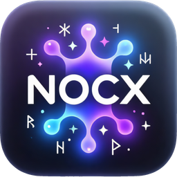

# nocx

<!-- Claims verified against docs/architecture.md, internal/vault/system, internal/vault/vault.go, internal/profile/profile.go, internal/importer/tabby.go, internal/apicoll/collection.go and internal/apiimport. -->

**A local-first terminal built on the platform WebView rather than Chromium.** On macOS it uses WKWebView; the Linux AppImage carries WebKitGTK. It claims no memory advantage over another terminal; the one memory figure this README states is its own renderer's, under [Measured renderer memory](#measured-renderer-memory).

1. **A native WebView by construction.** Wails uses the platform WebView—WKWebView on macOS and WebKitGTK on Linux—instead of Chromium. The Linux AppImage carries its WebKitGTK runtime. This describes the runtime architecture, not a measured advantage over another terminal.
2. **Secrets stay references.** nocx stores secrets in an OS-keychain provider or its encrypted file provider; command history keeps a reference in place of the secret value.
3. **SSH connections stay organized.** Create profiles and groups, and link passwords or key passphrases from the vault. Tabby profiles and groups can be imported; `~/.ssh/config` aliases can be resolved, not imported.
4. **An API client lives in your terminal.** Organize requests into file-backed collections, use environments, and import Postman collections. It is a focused API client, not a claim of full Postman feature parity.

Tabs, command output, notes and interface layout restore after restart; running processes do not resume. Files, Git, ports and transfers follow the active local or SSH tab.

**[nocx.dev](https://nocx.dev/)** — product overview and installation.

**Stack:** Go backend (PTY, SSH, session, transport) + client-painted cell renderer + Wails v3 desktop shell. Wails uses the platform WebView (WKWebView on macOS and WebKitGTK on Linux; the Linux AppImage carries WebKitGTK).

**Status:** `v0.6.1`, early release, no formal support. macOS (universal) and Linux (x86_64 AppImage). See the [0.6.1 release notes](docs/release-notes/v0.6.1.md).

## What makes it different

A terminal, SSH connection manager, secrets vault and file-backed API client in one local-first app. The assistant can act in the same scrollback, with user approval; the configured model provider’s data-retention policy still applies.

## Measured renderer memory

`e2e/renderer-memory-soak.spec.ts` drives the renderer in headless Chromium 149.0.7827.55: six tabs, twelve output-and-redraw rounds per tab, then eighteen close-and-reopen cycles with a redraw on each replacement, 52.7 s in total. It records `Performance.getMetrics` (including `JSHeapUsedSize`), document node counts, detached heap-node counts and a heap snapshot at each end of the run.

Before the fix, the snapshot taken after the eighteen cycles held 24 `Pane` and 24 `TerminalContent` objects, against a six-object baseline and a bound of 7. A module-level map keyed by session was populated when a session opened and never cleared when it closed, so it retained every closed pane content and its owner. After the fix the snapshot holds six `Pane` and six `TerminalContent` objects. Detached heap nodes are 6495 → 6466, live document nodes 1956 → 1951, no detached pane or editor DOM nodes remain, and `JSHeapUsedSize` after GC goes from 28.36 MB at the start of the run to 30.95 MB at the end — 2.59 MB, inside the 24 MB the check allows.

The claim is therefore narrow: closing and reopening panes no longer retains them, and the heap stays inside its bound. These are renderer JavaScript heap figures for that one workload — not whole-app memory, not process memory, and not a comparison with another terminal.

## Install (macOS)

Install the cask from our third-party tap:

```bash
brew install --cask shady2k/nocx/nocx
```

The cask removes `com.apple.quarantine` from `/Applications/nocx.app` after installation. This is an explicit trust choice: the tap clears macOS quarantine, just as the manual command below does. Read the [tap README](https://github.com/shady2k/homebrew-nocx) before installing.

### Direct download

Alternatively, download the `.dmg` from the [Releases page](https://github.com/shady2k/nocx/releases) and drag **nocx** into Applications. Direct downloads still need the manual quarantine step below.

There is no Apple Developer ID, so the build is unsigned and not notarized. macOS quarantines a downloaded app; clear that once, on first install:

```bash
xattr -dr com.apple.quarantine /Applications/nocx.app
```

Then open nocx normally. This is required only the first time — later in-app updates fetch the build directly and do not re-quarantine it. Confirm the version any time with `nocx --version`.

> No publisher signature and no notarization; the reasoning is in [ADR-0003](docs/decisions/0003-distribution-without-a-developer-id.md) and [ADR-0086](docs/decisions/0086-a-third-party-homebrew-tap-may-clear-quarantine-for-the-unsigned-cask.md). Update integrity is enforced by an ed25519-signed manifest, not by Gatekeeper.

## Install (Linux)

Install the latest release for x86_64 Linux into your user account:

```bash
curl -fsSL https://nocx.dev/install.sh | sh
```

The installer verifies the release manifest signature and the AppImage before installing. OpenSSL 3+ is required; the script explains how to install it if it is missing or too old. It writes to `~/.local/bin` and needs no root access (see [ADR-0087](docs/decisions/0087-linux-user-installs-use-the-signed-release-manifest.md)).

For a manual install, download the `.AppImage` from the [Releases page](https://github.com/shady2k/nocx/releases), make it executable, and run it:

```bash
chmod +x nocx-*-linux-amd64.AppImage
./nocx-*-linux-amd64.AppImage
```

The AppImage is a single self-contained file. In-app updates replace it in place (see [ADR-0007](docs/decisions/0007-cross-platform-auto-update.md)).

### Support envelope

The AppImage carries its own GTK 3 and WebKitGTK — the library **and** WebKitGTK's
helper processes, which is what lets it run where the host has no
`libwebkit2gtk-4.1` at all, and not only on Debian-shaped filesystems
([ADR-0035](docs/decisions/0035-appimage-carries-webkits-helper-processes.md)).
It links against **glibc 2.35** (the floor set by building on ubuntu-22.04).

It is self-contained in its **application** stack, not independent of a Linux
desktop: fonts and text shaping come from the host, deliberately, so that text
renders in your fonts rather than ours. In practice that means `fontconfig`,
`freetype`, `fribidi` and `harfbuzz` — present on every desktop install, absent
in a bare container, where the app will not start.

**This means it runs on distributions at or above that baseline**, including
Ubuntu 22.04+, Debian 12+, Fedora 39+, RHEL 9+, and Arch (rolling). It is
**not** "runs everywhere" — older enterprise distributions (RHEL 8, Ubuntu 20.04)
carry an earlier glibc and are not supported. If the AppImage refuses to start
and `ldd --version` reports a glibc before 2.35, the distribution is below the
floor.

> If the `APPIMAGE` environment variable is not set at runtime (e.g. you
> extracted the AppImage or installed via a package manager), in-app updates are
> silently disabled — the updater only engages when the app is running as an
> AppImage, mirroring the macOS refusals for dev and translocated builds
> ([ADR-0007](docs/decisions/0007-cross-platform-auto-update.md) §Decision).

## Rollback procedures

If an update fails or you need to return to the previous version, these
manual recovery paths cover both states an update can be in (§7.5 of the
distribution-and-updates design).

### After a successful update (to the retained known-good backup)

The previous version is saved as `.nocx-backup.app` (macOS) or
`.nocx-backup.AppImage` (Linux) next to the active bundle.

**macOS:**

```bash
osascript -e 'quit app "nocx"'
rm -rf /Applications/nocx.app
mv /Applications/.nocx-backup.app /Applications/nocx.app
```

**Linux:**

```bash
killall nocx
mv ~/.local/bin/.nocx-backup.AppImage ~/.local/bin/nocx.AppImage
```

### During a failed update (before health was ever confirmed)

If nocx was restarted after an update and something is broken — a JS
exception, a blank window, or the app exits before `ReportHealthy` ever
runs — the new bundle sits at the install path and the swap file holds
the previous working version.

**macOS:**

```bash
osascript -e 'quit app "nocx"'
rm -rf /Applications/nocx.app
mv /Applications/.nocx-swap.app /Applications/nocx.app
rm -f ~/Library/Application\ Support/nocx/.nocx-update-journal.json
```

**Linux:**

```bash
killall nocx
# The swap file is the previous AppImage; exchange it back.
mv ~/.local/bin/.nocx-swap.app ~/.local/bin/nocx.AppImage
rm -f ~/.local/bin/.nocx-update-journal.json
```

> The updater also performs an automatic rollback after three launches that
> reach Go without a successful `ReportHealthy` call — the feature above is
> for cases where the new build never reaches Go at all (e.g. a dyld failure).

## Prerequisites

| Tool            | Version           | Install                                                                                                            |
| --------------- | ----------------- | ------------------------------------------------------------------------------------------------------------------ |
| Go              | 1.26              | [go.dev](https://go.dev/dl/)                                                                                       |
| Node            | 24                | [nodejs.org](https://nodejs.org/)                                                                                  |
| Wails CLI       | **^3.0.0-beta.9** | `go install github.com/wailsapp/wails/v3/cmd/wails3@v3.0.0-beta.9`                                                 |
| gofumpt         | latest            | `go install mvdan.cc/gofumpt@latest`                                                                               |
| golangci-lint   | **v1.64.8**       | `go install github.com/golangci/golangci-lint/cmd/golangci-lint@v1.64.8`                                           |
| br (beads_rust) | latest            | `curl -fsSL https://raw.githubusercontent.com/Dicklesworthstone/beads_rust/main/install.sh \| bash -s -- --verify` |

> ⚠️ golangci-lint **must** be v1.64.8 — the config (`.golangci.yml`) uses the v1
> schema, and golangci-lint v2 rejects it. Pinning is enforced in CI.

> The tracker was `bd` (Go beads, embedded Dolt) until 2026-09-05 and is `br`
> now. `br` is a single static binary with no daemon and no Dolt; it never runs
> git. `br` has no memory store at all. See AGENTS.md.

**On NixOS / without Homebrew.** `brew` and `npm i -g` don't work here — the
latter writes into the read-only Nix store. Install `go`, `nodejs_24`, `gofumpt`,
and `uv` from nixpkgs, put `~/go/bin` and `~/.local/bin` on your `PATH`, then get
the rest through the language toolchains:

```bash
go install github.com/wailsapp/wails/v3/cmd/wails3@v3.0.0-beta.9
go install github.com/golangci/golangci-lint/cmd/golangci-lint@v1.64.8   # exactly this — nixpkgs ships v2, which rejects .golangci.yml

# The tracker: release binary into ~/.local/bin.
curl -fsSL "https://raw.githubusercontent.com/Dicklesworthstone/beads_rust/main/install.sh?$(date +%s)" \
  | bash -s -- --dest ~/.local/bin --skip-skills --verify
```

`br` is not in nixpkgs and is static: its Linux musl artifact runs as-is, so
`nix-ld` is no longer needed. Add **`minisign`** and **`sqlite3`** from nixpkgs
while you are there:
the first verifies `br`'s release signatures, the second is how you look at the
database when `br doctor` disagrees with you. The `beads-superpowers` plugin
installs via `claude` — see
[Agent tooling](#agent-tooling).

## Getting started

```bash
git clone <repo-url> && cd nocx

# One command: git hooks, issue tracker, and both dependency trees
make init

# Run in development mode
make dev

# …with the web inspector open, when you need a console
NOCX_DEVTOOLS=1 make dev
```

> **There is no `wails dev`.** Wails v3 has no dev CLI without a Taskfile, this
> repository has no Taskfile, and inventing one to replicate the watcher was not
> worth it (see the `dev` target in the Makefile). `wails3 dev` therefore fails
> on a missing `build/config.yml` — a file `.gitignore` excludes, so no clone
> will ever have one. `make dev` builds the frontend, which `//go:embed
all:frontend/dist` needs populated before the Go compiler runs, and then runs
> the app against the development profile.

> For iterating on the frontend, `make dev-web` is the faster loop: the same app
> in an ordinary browser, backed by the real Go backend on a real PTY. It needs
> no webview and no display.

> The inspector needs the flag because right-click cannot reach it: the window
> disables the default context menu, and the terminal surface uses the right
> button to paste. The flag applies to dev/debug builds only.

> `make init` assumes the [Prerequisites](#prerequisites) and [Agent tooling](#agent-tooling)
> are already installed — it sets up the repo (hooks, backlog, dependencies), not
> your machine.

`make init` is safe to re-run, and does three things:

| Step                | Why it matters                                                                                                                                                                                                            |
| ------------------- | ------------------------------------------------------------------------------------------------------------------------------------------------------------------------------------------------------------------------- |
| `make connect`      | `git config core.hooksPath .githooks` and `br sync --import-only`, after checking every input a hook reads: `node`, `br`, the hook scripts, the backlog gate's files. Anything missing is named and nothing is connected. |
| `npm ci` (root)     | `@playwright/test`, for the e2e suite.                                                                                                                                                                                    |
| `npm ci` (frontend) | The app's own dependencies.                                                                                                                                                                                               |

The backlog needs no bootstrapping: `.beads/issues.jsonl` is a tracked file, so a
clone already has every issue and `br` builds its SQLite from it on the first
command. `make connect` just does that eagerly. What a clone can lack is `br` itself
— git carries the data, not the tool — and without it `make connect` refuses and says
where to get it, because the commit-message hook resolves tasks through `br`.

The e2e suite additionally needs its browser once: `npx playwright install chromium`.

**Terminal font.** In **Settings → Terminal → Font family**, choose **Nordwand
Mono** to use the bundled [Nordwand Mono 1.3.4](https://github.com/tywr/Nordwand-Mono/releases/tag/1.3.4)
without installing a font or downloading one at runtime. Regular, italic, bold,
and bold italic are included under the [SIL Open Font License](frontend/public/fonts/nordwand-mono/LICENSE-FONT.txt).
The choice applies to the command editor and terminal output, is saved across
restarts, and leaves the accepted terminal grid unchanged when switched live.
**System default** restores the theme's original font stack and remains the default.

**Native Fish.** Helper-hosted Fish preserves its normal configuration order,
universal variables, history and prompt functions; it does not run through Bash.
The verified startup prelude is Fish 4.9.3's
([ADR-0099](docs/decisions/0099-fish-keeps-native-startup-and-the-helper-adapts-its-private-io.md)).
An unverified prelude remains a conventional terminal. Its integration notice names
the detected Fish version (or says it could not be detected) and the audited 4.9.3
prelude, rather than reporting a generic unsupported shell or timeout. Compatibility
is determined by that prelude, not version equality; ADR-0099 describes the source
audit and Linux/macOS checks required to admit a changed prelude.
Fish without a helper on a remote host is not claimed as enhanced support.
The existing login-shell resolver selects a valid account-database shell before
`$SHELL`; exporting `SHELL=fish` does not override that record. Configured agent
commands cannot replace native Fish builtins, functions or autoload names: a
collision is reported and that agent record must be renamed.

The pre-commit hook runs on every `git commit` and enforces **static** checks
only — nothing below is executed, only read (`nocx-hzsiv`):

- `gofumpt` — format check (fails if any file needs formatting)
- `golangci-lint` — lint
- the control-goroutine ratchet — Go changes only
- `prettier --check` and root `eslint` — the whole repository
- `eslint` — frontend lint, plus the fixture and dead-export ratchets
- `contracts:check` — the generated wire types match the schemas
- `tsc --noEmit` — the frontend and the e2e suite
- backlog rules and commit task links — through the project integration
- product-document form and references — staged content only

**No test runs on commit**, and no container is started: the hook needs no
docker daemon. Tests live at three addresses instead — `make test` on demand,
`make ci-full` which the integrator runs once on the merged tree, and CI on
every pull request. The trade is deliberate: a commit can be made whose tests
do not pass, in exchange for a gate that takes seconds and cannot be starved
into misreporting which check failed (`nocx-y6d9j`).

The pre-push hook checks the commits that the target remote does not already hold.
Every introduced commit must name an existing leaf task; its published backlog
must add no new problems. A new tag or branch on commits already held by that
remote passes visibly without rechecking history. Empty hook input or unreadable
gate inputs refuse the push and name `make connect`; no product suite runs here.

The tracker still travels as the tracked `.beads/issues.jsonl` export, not a
separate push. Unflushed database changes or an uncommitted export produce a
warning so the publisher can send their tracker changes with their code.

There are no post-merge or post-rewrite hooks. `git pull` brings a colleague's
export in as a file change; the database can also hold newer local work.
Reconcile them through [Backlog integration](docs/agents/backlog.md) before
tracker writes or publication. Never use `br sync --merge` merely because the
database is ahead: it can remove tasks that have not reached the export.

**The tracker was `bd` (Go beads, embedded Dolt) until 2026-09-05.** It moved to
`br` because Dolt's failures compounded: a pull that could not recover a clone
which had fallen behind, a remote cache that grew ~210 MB per aborted attempt and
never pruned, and a process that ignored SIGTERM while holding the store lock, so
every worktree on the machine queued behind it (`nocx-v48vl`). The store went from
1.9 GB to about 22 MB. Migration is recorded in
`.internal/specs/2026-09-05-bd-to-br-migration-design.md`, and the two scripts that
did it — `scripts/bd-to-br-transform.py` and `scripts/bd-to-br-verify.py` — are
kept so a second machine can repeat and re-check it.

If `br` or a required gate input is missing in a configured tree, the push is refused;
`make connect` reports what must be supplied.

Claiming a task is the one moment where a stale backlog actually costs something;
`AGENTS.md` has the claim protocol.

All four frontend gates FAIL with an actionable message if `node_modules` is absent (run `cd frontend && npm ci`).

Run locally without committing: `make ci` (close mirror of CI — runs the same static analysis and tests, but validates against your existing `node_modules` rather than reinstalling).

**Shell integration tests drive real Bash, Zsh, POSIX shells and native Fish.**
`internal/shellintegration` launches them on real PTYs. The dash and zsh tests
**fail, not skip**, when a required shell is absent. Install them before running
the suite:

```bash
sudo apt-get install -y dash zsh        # Debian/Ubuntu
brew install dash                       # macOS (zsh ships with the OS)
go test -race -count=1 ./internal/shellintegration/...
```

Native Fish acceptance requires the pinned 4.9.3 executable, not a skipped test.
Provision it with `scripts/install-fish-ci.sh ~/.cache/nocx-fish-ci`, put
`~/.cache/nocx-fish-ci/bin` first on `PATH`, and set
`NOCX_REQUIRE_NATIVE_FISH=1` for `TestNativeFish_` checks. The installer verifies
the upstream archive digest and uses a private prefix; it changes neither the
account shell nor the system Fish installation.

The idle-Ctrl+C journey establishes the same prompt's native reader boundary
(OSC 133 B, ST-terminated) after nocx's prompt-start marker, so the product key
encoder has consumed Fish's keyboard-protocol setup. Authenticated readiness
alone can arrive during prompt construction. The next command still follows
Ctrl+C immediately, without a cancellation delay; cancelling a prompt function
is a different native Fish phase, not an idle-input precondition.

Agent-report assertions also wait for the authenticated command completion and
its render fence before reading a whole PTY snapshot. A withdrawal event, a
complete argv file or the first output marker does not drain the independent
PTY pump.

The widget-wrapping zsh plugins — `fast-syntax-highlighting`,
`zsh-syntax-highlighting`, `zsh-autosuggestions` — are needed by the one test
about composing with a plugin stack (`nocx-1ebrs.27`), and that test **fails,
not skips**, when they are missing. Provision the PINNED checkouts, because a
package manager's bottles move and then a green run stops saying which widget
wrapping it measured:

```bash
scripts/install-zsh-zle-plugins.sh ~/.cache/nocx-zsh-plugins
NOCX_ZSH_PLUGINS=~/.cache/nocx-zsh-plugins \
  go test -race -count=1 -run TestLocalZshPane_ThePluginStackIntegratesInEitherOrder \
  ./internal/shellintegration/
```

The gates that run this suite provision the shells so they prove them:
`scripts/ci-linux.sh` uses an image carrying dash, zsh and a real bash 3.2
(`.githooks/images/ci-linux/Dockerfile`), and CI's `ci-backend` job runs
`scripts/install-zsh-ci.sh`, which installs the pinned plugins as well.
Both runners also install the pinned Fish and require the native checks.
CI's macOS job provisions the same Fish release and the pinned zsh plugins,
then runs the native Fish checks and the plugin-composition test. The latter
was measured on a Mac, where the OS ships zsh 5.8. The pre-commit hook
provisions nothing: it runs no tests at all.

## Quality gates

Every commit must pass:

| Gate               | Pre-commit | `make ci` | CI (GitHub Actions) |
| ------------------ | ---------- | --------- | ------------------- |
| gofumpt (format)   | ✓          | ✓         | ✓                   |
| golangci-lint      | v1.64.8    | v1.64.8   | v1.64.8             |
| `go test -race`    | —          | ✓         | ✓                   |
| `go build ./...`   | —          | ✓         | ✓ (macos-latest)    |
| `prettier --check` | ✓          | ✓         | ✓                   |
| `eslint`           | ✓          | ✓         | ✓                   |
| `tsc --noEmit`     | ✓          | ✓         | ✓                   |
| `vitest`           | —          | ✓         | ✓                   |
| `npm run build`    | —          | ✓         | ✓                   |

The two dashes in the Pre-commit column are the whole of `nocx-hzsiv`: the
per-commit gate is static, and a green commit says the tree is formatted,
linted, type-checked and contract-current — nothing about whether it works.

CI (`ci.yml`) runs on every pull request to `main`, on release branches
(`release/**`) and manual dispatch, and is called by `release.yml` on a version
tag (`v*`) so a release gates on a green suite (GitHub Actions, macos-latest for
the Go and e2e jobs, ubuntu-latest for the frontend). The pull-request run is
what enforces **no merge without green** on `main`: the pre-commit hook and
`make ci` run the identical checks as fast local feedback, but a hook is
bypassable with `--no-verify` and `make connect` is a per-clone step a fresh
checkout may skip.

Running-command browser checks require output to intersect the viewport and pointer
actions to pass normal locator actionability. DOM/ARIA rows can survive inside a
collapsed live region; their presence, a minimum pixel height or a tab title is not
proof of visible output. Before releasing a command blocked on terminal input,
assert the terminal input owns focus without a corrective click; the editor and
terminal are distinct input owners, and automatic handoff is part of the contract.

## Task tracking — beads (br)

The executable backlog lives in beads, not markdown, and in `.beads/issues.jsonl`,
which is a tracked file — so a clone has it:

```bash
br ready                     # what to work on next (--epic/--parent/-t/-l to narrow)
br show <id>                 # view an issue
br update <id> --claim       # claim work
br close <id> --reason "..." # complete work, with evidence a stranger can check
br sync --flush-only && git add .beads/issues.jsonl   # send it out with the code
```

`br` never runs git: the last line is yours to type, and nothing does it for you.
See `AGENTS.md` for the full workflow and for the `bd` → `br` table, which the
`beads-superpowers` plugin still needs.

## Sources of truth

| File                         | What it contains                                                                                           |
| ---------------------------- | ---------------------------------------------------------------------------------------------------------- |
| `AGENTS.md`                  | Binding engineering rules for all contributors (human and AI)                                              |
| `docs/architecture.md`       | Architecture spine with AD-1..AD-10 invariants                                                             |
| `docs/vision.md`             | Product vision, MVP scope, roadmap                                                                         |
| `docs/decisions/`            | Architecture Decision Records (append-only)                                                                |
| `docs/backup-and-restore.md` | What a backup carries, what it deliberately leaves behind, and how a restore recovers from an interruption |

## Repository layout

```
AGENTS.md               — binding contributor contract
Makefile                — lint, format, test, build, dev, ci, hooks
.githooks/              — quality gate + tracker sync (POSIX sh)
scripts/                — dev utilities (glyph probe, hook policy test)
.github/workflows/      — CI workflows

docs/                   — living docs (vision, architecture, decisions/)

internal/               — Go backend
  app/                    composition root
  config/                 settings, themes
  log/                    structured logging (slog adapter)
  pty/                    local pseudo-terminals
  session/                session registry and lifecycle
  ssh/                    SSH client (x/crypto/ssh)
  shellintegration/       OSC 7/133 substrate
  transport/              WebSocket server

frontend/               — TypeScript frontend (cell renderer + Wails)
  src/
    renderers/            cell renderer
    tabs.ts               tab manager + WS client
    ipc.ts                WebSocket protocol
    main.ts               app entry
  package.json

.claude/, .agents/      — vendored agent tooling
```

## Built by AI agents

Development is driven by AI coding agents. The repo vendors what it can under
`.claude/` and `.agents/`; the issue tracker and the Claude Code agent tooling
below are per-machine and you install them yourself.

### Agent tooling

Install these once per machine — they are **not** vendored, and `make init` does
not install them:

| Tool                                                                          | Needed for                                                           | Install                                                                                                                                   |
| ----------------------------------------------------------------------------- | -------------------------------------------------------------------- | ----------------------------------------------------------------------------------------------------------------------------------------- |
| `bd` (beads)                                                                  | The backlog — **required** (also in [Prerequisites](#prerequisites)) | `brew install beads` (or `npm i -g @beads/bd`)                                                                                            |
| [`beads-superpowers`](https://github.com/DollarDill/beads-superpowers) plugin | Superpowers skills + the `bd` session hooks — **recommended**        | `claude plugin marketplace add DollarDill/beads-superpowers` then `claude plugin install beads-superpowers@beads-superpowers-marketplace` |

- **Install `bd` before the plugin.** The plugin's hooks call `bd` on every
  session start, so a missing `bd` makes them fail.
- The `beads-superpowers` plugin bundles the Superpowers skill system with the
  Beads integration. It also targets Codex, OpenCode, Cursor and others — the
  [marketplace README](https://github.com/DollarDill/beads-superpowers) has the
  per-agent variant. (Inside a running session the same two steps are
  `/plugin marketplace add …` and `/plugin install …`.)

## License

TBD. Dependencies are MIT and Apache 2.0 — preserve their copyright notices:

- `vite` — MIT, © 2019–present VoidZero Inc. and Vite contributors (devDependency, build-time only)

The helper links `libghostty-vt` statically, and it brings licences no list
here could keep straight — ghostty, Highway, Wuffs, uucode, simdutf and Zig's
`compiler_rt` — so those are generated from the pinned archives instead of
copied: the shipped distribution carries them (`Contents/Resources/` in the
macOS bundle, `usr/share/doc/nocx/` in the AppImage) and
`nocx-helper --licenses` prints the helper's own copy. See
[`third_party/libghostty-vt/README.md`](third_party/libghostty-vt/README.md).
